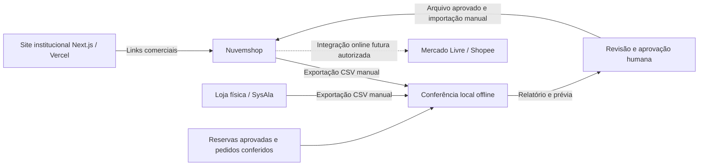

# Arquitetura — site institucional e operação comercial

## Limite do sistema

Este projeto reúne o institucional e o portal de relacionamento da Agylli. Varejo, checkout e pagamento online ficam na Nuvemshop. No escopo escolhido em 12/11/2026, a revenda usa catálogo próprio e solicitações para atendimento pela loja física/WhatsApp; a equipe confirma descontos e condições manualmente. Os quatro itens da homepage continuam exclusivamente ilustrativos, separados do catálogo comercial privado.

## Camadas

1. `app`: páginas e metadados por rota, layout comum e endpoints de SEO. A homepage, atacado, sobre e loja em breve são pré-renderizados. Contato é renderizado no servidor conforme o assunto da URL.
2. `components`: apresentação por contexto. Elementos de marketing podem compor futuras campanhas e páginas de captura. `PageIntro` e `ActionLink` são blocos compartilhados.
3. `config` e `data`: identidade e conteúdo editável separados da apresentação. Não usar esses arquivos como fonte de preços ou estoque.
4. `lib`: validação de URLs e contatos. Destinos comerciais aceitam apenas HTTPS sem credenciais. Valores ausentes ou inválidos produzem fallbacks internos.
5. `integrations`: adaptadores opcionais. O institucional não depende do Supabase para renderizar; páginas privadas usam Auth, banco e armazenamento com RLS.

## Decisões

- Next.js App Router, TypeScript estrito e Server Components por padrão. Menu, filtros, formulários e seleção de produtos usam interatividade no cliente quando necessária.
- Filtros usam query string (`?categoria=...`) e links reais, permitindo compartilhamento, voltar/avançar e navegação acessível. Não simulam uma busca no catálogo real.
- Tailwind CSS v4 com `@theme` centralizado e classes semânticas de composição para manter a identidade legível. Fontes servidas localmente por Fontsource.
- Fotografias reais de referência em WebP local e `next/image` para otimização e preload do hero. Logos originais em arquivos locais. Os fornecedores não são consultados em runtime; a seleção ilustrativa não sincroniza estoque, preços ou pedidos.
- SEO inclui idioma, título por página, description, Open Graph, robots e sitemap. Até definir `NEXT_PUBLIC_SITE_URL`, o site permanece `noindex`. A Vercel também deve proteger previews de indexação.
- Cabeçalhos básicos incluem `nosniff`, `DENY`, política de referência e bloqueio de câmera/microfone/geolocalização. O portal usa cookies de autenticação; analytics continuam inativos.
- Formulários, sessões e tabelas privadas atendem ao escopo aprovado do portal, com RLS. A seleção de produtos registra solicitações; não há checkout, pagamento ou estoque no institucional. Nenhum botão informa um envio que não aconteceu.

## Crescimento

Campanhas podem entrar em `src/app/(marketing)/campanhas/...`, reutilizando os componentes atuais. Adicionar um CMS ou API de catálogo somente após definir autoria, atualização, cache e direitos de acesso. Não transformar dados demonstrativos em catálogo de produção sem validação comercial.

Antes de coletar leads, aprovar finalidade, política de privacidade, retenção, consentimento quando aplicável, antispam e destino de atendimento. Antes de ativar autenticação ou tabelas no Supabase, definir autorização e RLS e adicionar testes para esses limites.

## Unidades e atendimento

`src/config/locations.ts` centraliza as duas unidades, suas regiões, endereços, links `tel:`/WhatsApp e o mapa institucional. `LocationCards` é reutilizado nas rotas `/contato` e `/onde-atuamos`; o rodapé consome a mesma configuração. Canais gerais adicionais continuam opcionais via ambiente, sem substituir os contatos das unidades. Solicitação de revenda direciona aos canais das equipes enquanto não há área B2B; não há coleta de documentos ou confirmação de cadastro.

## Preparação comercial da Etapa 2

`WholesaleAccess` define o espaço de cadastro B2B sem banco ou formulário local. A URL é a mesma dos demais CTAs de acesso. `docs/modelos/` contém somente modelos de preparação; não é carregado pela aplicação nem mantém estoque. Dados reais ficam fora do Git/deploy em `dados-comerciais/`. Mensuração está especificada em `mensuracao.md`, sem tags, listeners, cookies ou IDs adicionados ao runtime.

## Revisão definitiva: SysAla manual e preparação da Etapa 4

- SysAla é o sistema da loja física; não possui API, webhook ou sincronização automática. O intercâmbio disponível é CSV exportado manualmente.
- Nuvemshop é a plataforma de varejo/B2B e operações do e-commerce. Mercado Livre e Shopee serão integrados futuramente à operação online, não diretamente ao SysAla.
- A operação pode reservar fisicamente mercadoria para o online. Saldo físico, reserva bruta aprovada, compromissos e disponibilidade online têm significados distintos; não igualar saldos automaticamente.
- `tools/conciliacao/` contém uma CLI Python offline, fora do site e sem banco. Ela preserva retratos por lote, confere, limita propostas à reserva líquida e gera prévia; arquivo local final depende de modelo oficial e aprovação humana. A importação continua manual.
- O código administrativo é excluído do pacote Vercel e dos traces do Next. Não há rota web, cron, API ou dependência runtime do utilitário no site. Dados/originais/relatórios comerciais ficam em `dados-comerciais/` ou pasta privada fora de Git, nunca em `public/`.

Não há seta de sincronização automática SysAla → Nuvemshop. O utilitário registra auditoria de retratos e decisões, não mantém saldo contínuo nem substitui os sistemas oficiais. Movimentos online ainda não refletidos no ERP precisam ser declarados no registro conferido; não são deduzidos da diferença entre dois arquivos de saldo.

Procedimento diário, papéis, janela de importação e resolução de diferenças: [conciliação manual](conciliacao-manual.md).

## Portal de relacionamento — 11/11/2026

Novo escopo aprovado: Supabase Auth e banco com RLS para revendedores, aprovação manual, solicitações destinadas à loja física, materiais privados e painel da equipe com e-mail. Varejo/checkout seguem na Nuvemshop. O portal não calcula preços nem controla saldo. Histórico SysAla depende de CSV autorizado e vinculação explícita ao UUID do cliente. [Arquitetura, schema e limites](portal-revendedor.md). As premissas de etapas anteriores sobre ausência de cadastros são históricas para este novo escopo.

## Catálogo próprio e WhatsApp — 12/11/2026

[Detalhamento e ativação](catalogo-revenda.md). `reseller_catalog_products` contém apenas apresentação e publicação de produtos. A função transacional `portal_create_catalog_request` resolve IDs ativos, preserva nome/código e mantém idempotência; a solicitação fica no mesmo histórico/painel e outbox existentes. WhatsApp é uma passagem explícita para atendimento humano, sem API de envio, pagamento ou confirmação de recebimento. Não há preço/estoque duplicado nem integração automática SysAla.
