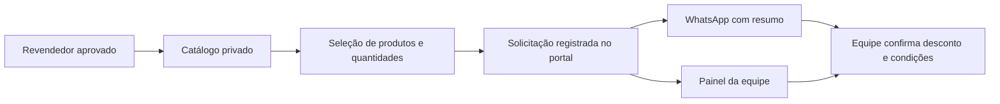

# Catálogo próprio de revenda e atendimento pelo WhatsApp

Escopo escolhido pela Agylli em 12/11/2026: catálogo **próprio para revenda**, independente do catálogo Nuvemshop. A loja aplica os descontos manualmente no atendimento. Varejo e checkout online continuam na Nuvemshop; estoque físico permanece no SysAla, sem API/sincronização automática.

## Jornada

1. Revendedor entra e recebe aprovação da equipe.
2. Abre **Produtos para revenda** (`/revendedor/produtos`), busca por nome/código/marca ou filtra categoria.
3. Adiciona produtos, ajusta quantidades e revisa o pedido. Até 20 produtos, de 1 a 99 unidades de cada. A seleção permanece durante os filtros, na página atual; sair/recarregar antes de registrar descarta esse rascunho.
4. Registra a solicitação no portal. O banco resolve os IDs para os nomes/códigos oficiais, preserva o snapshot, cria o andamento e o aviso pendente de e-mail. Mesmo token/conteúdo não duplica pedido.
5. Abre o WhatsApp com referência, produtos, códigos e quantidades. **O visitante ainda precisa tocar em Enviar no WhatsApp.** Não há integração WhatsApp Business/API nem confirmação automática de entrega da mensagem.
6. Equipe consulta o pedido no painel e confirma disponibilidade física, desconto vigente, valor final, pagamento e entrega diretamente com o revendedor. Atualiza o andamento no painel.

O catálogo guarda apenas apresentação: nome, código/SKU opcional, marca, categoria, descrição, fotografia e publicação. **Não há preços, custos, regras automáticas de desconto, reserva, saldo ou pagamento.** A solicitação não representa venda concluída. Marcar entregue não cria compra confirmada automaticamente; histórico físico continua dependente de vinculação/CSV autorizados.

## Ativar no Supabase

1. Pré-requisitos: migration original do portal aplicada, Auth/URLs configurados e primeira conta da equipe autorizada em `portal_staff`.
2. Revisar e aplicar **uma vez**, pelo SQL Editor autorizado, [202611120001_reseller_catalog.sql](../supabase/migrations/202611120001_reseller_catalog.sql). É aditiva e transacional: cria a tabela, as políticas, o bucket privado e a função de solicitação por IDs; acrescenta `catalog_selection` aos pedidos existentes. Não apaga dados nem altera usuários/estoques. Se houver nomes já existentes, investigar antes de repetir/alterar o script.
3. Abrir `/equipe/produtos` com uma conta da equipe. Cadastrar produtos reais e fotos autorizadas. Código é texto, preserva zeros e deve ser único quando informado. Não preencher códigos ou atributos que a Agylli não confirmou.
4. Marcar **Publicar para revendedores aprovados**. Produto oculto fica apenas para a equipe e não pode entrar em novas solicitações. Pedidos anteriores preservam seus dados.
5. Aprovar uma conta de revendedor com e-mail confirmado e testar `/revendedor/produtos`. A equipe pode visualizar o catálogo em modo de prévia; isso não concede à sua conta pessoal permissão de comprar como revendedor.

Nenhuma nova variável de ambiente é necessária. Usar as três variáveis existentes Supabase/site e o WhatsApp da unidade centralizado em `src/config/locations.ts`: atualmente Cândido Sales, `(77) 98854-9691`. A configuração de e-mail da loja continua opcional e separada; sua ausência não perde o pedido nem impede a preparação do WhatsApp.

## Produto e fotografia

- Nome: identificar o produto e a variação real (cor, volume etc.). Cada variação solicitável tem sua própria entrada/código, quando houver.
- Código/SKU: opcional, único, até 80 caracteres. Usar o código real da operação; não gerar EAN/SKU fictícios.
- Marca e categoria: opcionais; adotar nomes consistentes para os filtros.
- Descrição: informação aprovada, até 1.000 caracteres, sem promessas não comprovadas.
- Foto: JPG, PNG ou WebP, até 3 MB, assinatura validada. Recomenda-se WebP comprimido, fundo claro e enquadramento uniforme. Ausência de foto mostra espaço reservado.
- Autorização: operador confirma a conferência dos dados/direito de uso antes de salvar.

Bucket `reseller-products` é privado; aprovados leem somente fotos de produtos ativos e equipe gerencia arquivos. URLs de foto assinadas duram até uma hora; ocultar um produto bloqueia novas assinaturas, mas não invalida URLs já emitidas antes da expiração. As fotos privadas usam imagem sem o cache público do otimizador Next.js. A primeira versão carrega até 500 produtos para busca local e mostra 20 cards por vez.

O [modelo de preparação](modelos/catalogo-revenda-metadados.csv) contém apenas cabeçalhos, sem dados comerciais. **Não é um importador nem um layout nativo SysAla/Nuvemshop.** Cadastro em lote é uma etapa futura após receber uma lista real, fotos autorizadas e validar mapeamento/duplicidades; os produtos atuais podem ser cadastrados pela equipe no painel.

## Segurança e histórico

- Todas as tabelas/funções usam o Auth/RLS do portal. Usuário pendente, suspenso ou anônimo não acessa o catálogo comercial. Aprovação é refeita no servidor e na função SQL ao registrar.
- Cliente envia somente IDs/quantidades. Nome e código são obtidos de produtos ativos dentro da transação. Campos extras, preços forjados, duplicidades e quantidades inválidas são recusados.
- Mesmo token com alteração de conteúdo é bloqueado; repetição legítima usa o snapshot original mesmo após edição/ocultação do produto. Seleção de outra pessoa não é acessível.
- Nenhum custo, preço ou saldo é incluído em código, fixtures de produção ou Git. O catálogo inicia vazio.
- WhatsApp recebe dados mínimos, sem e-mail, documentos ou observações privadas no link. O link do pedido exige login da equipe. Listas muito longas usam resumo com link; o texto completo pode ser copiado manualmente.
- Se o link do painel solicitar login, entrar com a conta da equipe e abrir novamente o link da mensagem para consultar o pedido específico.
- Abrir/copiar mensagem não marca envio, não altera status comercial e não confirma uma compra.
- Sem conexão, o portal informa falha ao registrar; não abre WhatsApp fingindo que o pedido foi salvo.

## Homologação com produtos reais

1. Publicar um produto real com código conferido e foto autorizada.
2. Conta pendente não deve ver o catálogo; conta aprovada deve vê-lo.
3. Buscar, filtrar, adicionar, alterar quantidade e remover; conferir o resumo.
4. Registrar uma solicitação autorizada e confirmar o mesmo ID no histórico e no painel da equipe. Repetir o mesmo envio não deve duplicar.
5. Conferir destinatário e texto antes de tocar em Enviar no WhatsApp. Essa etapa real deve ser feita por operador autorizado; não foi executada automaticamente na implementação.
6. Equipe aplica o desconto vigente e confirma as condições. Sem promessa de percentual ou disponibilidade do catálogo.
7. Ocultar produto e confirmar bloqueio de novos pedidos; histórico anterior deve permanecer.

Capturas com dados **exclusivamente fictícios de teste local** ficam em `docs/screenshots/catalogo-revenda-local-*.png`. A rota temporária de prévia é removida antes do build e não é publicada.
