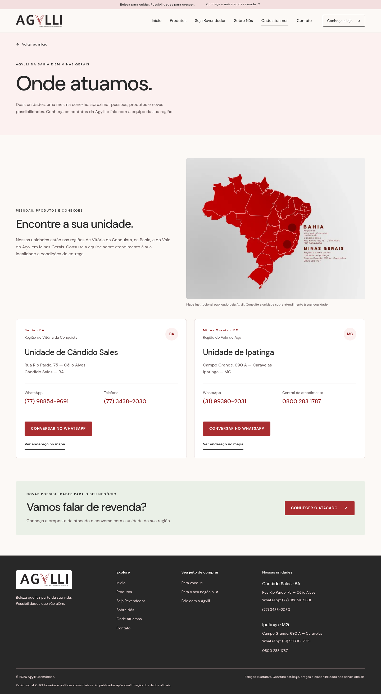
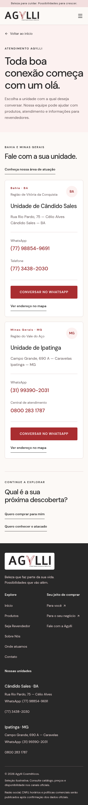

# Relatório de situação — Agylli Cosméticos

Registro histórico: o planejamento SysAla deste retrato foi superado pela confirmação de que não há API, webhooks ou sincronização automática. Valem agora a arquitetura revisada e o procedimento CSV manual em `docs/conciliacao-manual.md`.

Data: 5 de novembro de 2026. Conferência: 05/11/2026 15:37 UTC.


## Agylli Cosméticos
Relatório de entregas e próximos passos

**A base visual e técnica da Etapa 1 foi entregue e publicada.** O site apresenta a marca, diferencia varejo e atacado e permite contato com as duas unidades. A operação de vendas online ainda depende da configuração da Nuvemshop.

6 páginas desenvolvidas · 2 unidades com contatos · 41 testes na última validação

**Site publicado:** [https://agylli.vercel.app/](https://agylli.vercel.app/) · **Data do relatório:** 5 de novembro de 2026.

| Frente | Situação atual |
| --- | --- |
| Identidade e interface | Entregues: logo original, paleta bordô/preto, fontes maiores e layout responsivo. |
| Conteúdo institucional | História, apresentação de revenda, marcas de referência e área de atuação incorporadas. |
| Atendimento | Contatos de Cândido Sales/BA e Ipatinga/MG disponíveis com links de WhatsApp, telefone e mapa. |
| Publicação | Produção na conta Vercel Agylli; deployment confirmado como READY. |
| Vendas online | Estrutura de direcionamento preparada; varejo e cadastro B2B ainda aguardam os destinos oficiais. |


### Principais entregas

- Homepage com as chamadas “Comprar no varejo” e “Comprar no atacado”, categorias, seleção ilustrativa, revenda e atendimento.
- Logo e cores obtidas do site oficial; fotografias reais de Suave Fragrance e D’Bianco e logos das marcas indicadas.
- História e informações de revendedores revisadas a partir das fontes oficiais e do conteúdo fornecido.
- Remoção das estrelas e dos asteriscos decorativos em todas as páginas, conforme sua confirmação.
- Código organizado, documentação, testes e preparação para futuras integrações.


## Páginas e atendimento
O que o visitante encontra hoje

| Página | O que foi implementado |
| --- | --- |
| Início — / | Apresentação da marca e dos dois públicos, categorias, produtos ilustrativos, marcas, revenda e atendimento. |
| Atacado — /atacado | Proposta de revenda, CPF/CNPJ, benefícios, etapas, perguntas frequentes e solicitação de informações. |
| Sobre — /sobre | História, proposta da empresa, portfólio institucional e fotografia da loja. |
| Contato — /contato | Endereços, telefones, WhatsApp e links de localização das duas unidades. |
| Onde atuamos — /onde-atuamos | Mapa institucional, regiões de atuação e contatos por unidade. |
| Loja em breve — /loja-em-breve | Página provisória funcional enquanto a URL oficial do varejo não está configurada. |


### Jornadas disponíveis

- **Varejo:** botão de compra → loja em breve. Após configurar a URL, os links passam a direcionar à Nuvemshop.
- **Revenda:** apresentação de atacado → contato de revenda → WhatsApp ou telefone da unidade. O site ainda não recebe documentos nem confirma cadastro.
- **Produtos:** as categorias filtram as quatro referências ilustrativas e preservam voltar/avançar do navegador.

**Cândido Sales · BA** — Região de Vitória da Conquista
Rua Rio Pardo, 75 — Célio Alves
WhatsApp: (77) 98854-9691 · Telefone: (77) 3438-2030

**Ipatinga · MG** — Região do Vale do Aço
Campo Grande, 690 A — Caravelas
WhatsApp: (31) 99390-2031 · Telefone: 0800 283 1787

O conteúdo institucional menciona mais de 600 itens. A seleção deste site tem somente quatro referências visuais, com nomes e fotos reais, sem catálogo completo, preços ou disponibilidade sincronizada. Facinatus aparece com sua logo; suas fotos de produto ainda não foram incorporadas.


## Tecnologia e validação
Estrutura preparada para continuar o desenvolvimento

**Tecnologias:** Next.js 16.4.5 com App Router, React 19.3.1, TypeScript 6.0.3, Tailwind CSS 4.3.4 e Node.js 24 LTS. Qualidade com ESLint 10.14.0, Vitest 5.1.0, Playwright 1.64.1 e axe. Cliente Supabase 2.119.0 preparado para uso futuro.


### Organização do código

```text
src/app/              páginas, layouts, metadados e estilos
src/components/       cabeçalho, rodapé e blocos reutilizáveis
src/config/           marca, textos, contatos e unidades
src/data/             categorias e seleção ilustrativa
src/integrations/     cliente Supabase opcional
public/images/        logos, fotografias e mapa locais
tests/ e docs/        testes, documentação e capturas
```


### Configurações da próxima etapa

- **NEXT_PUBLIC_NUVEMSHOP_URL:** destino oficial do varejo.
- **NEXT_PUBLIC_NUVEMSHOP_B2B_URL:** destino oficial da área de revendedores.
- **NEXT_PUBLIC_SITE_URL:** domínio oficial para SEO. Sem ele, a aplicação permanece com noindex.
- **Supabase:** URL e chave publicável somente quando houver uma funcionalidade aprovada que precise do serviço.


### Cuidados implementados

- Navegação por teclado, foco visível, link para pular ao conteúdo, menu móvel e suporte a redução de movimento.
- Fontes locais, fotos em WebP, otimização pelo Next/Image e conteúdo sem dependência de conexão ao Supabase.
- Metadados por página, sitemap e robots preparados; URLs comerciais inválidas usam destinos internos seguros.
- Segredos fora do repositório e cabeçalhos básicos de segurança. Checkout, pagamento e estoque permanecem no escopo futuro da plataforma comercial.


## Verificações realizadas
Resultados locais, prévias e limites da validação


### Resultado da última validação antes do deploy

| Verificação | Resultado registrado |
| --- | --- |
| ESLint | Passou, sem erros e sem avisos. |
| Testes unitários | 11 passaram; cobrem validação de URLs/contatos e configuração opcional do Supabase. |
| Build e TypeScript | Build de produção e verificação de tipos passaram. |
| Testes de navegador | 30 passaram; seis páginas e fluxos em 375, 768 e 1440 px. |
| Acessibilidade automatizada | Nenhuma violação detectada pelo axe nos critérios WCAG A/AA testados. |
| Evidências visuais | 18 capturas, incluindo as seis páginas nas três larguras. |





Esses resultados vêm da última validação local, não de uma nova execução para este relatório. Não equivalem a auditoria completa de segurança/acessibilidade nem a medição de Core Web Vitals em produção. O CI está preparado; a execução remota para as alterações recentes ainda não foi verificada.


## Pendências para avançar
Prioridades de execução e critérios de conclusão

| Prioridade | Próxima ação | Como considerar concluída |
| --- | --- | --- |
| 1 · GitHub | Consolidar e enviar as alterações recentes ao repositório Agylli/Agylli. | Código publicado na Vercel também disponível no GitHub, com execução do CI acompanhada. |
| 2 · Varejo | Definir a loja Nuvemshop e sua URL oficial. | Botões direcionam à loja correta; compra, pagamento e entrega validados na Nuvemshop. |
| 3 · Atacado | Validar recursos/plano B2B, regras e destino de cadastro. | Canal oficial de cadastro conectado; CPF/CNPJ, aprovação, preços e condições comerciais confirmados. |
| 4 · Domínio e SEO | Definir a migração para o domínio oficial e configurar a URL canônica. | Domínio e DNS validados; NEXT_PUBLIC_SITE_URL configurada; robots, sitemap e indexação revistos. |
| 5 · Catálogo | Definir catálogo comercial, SKUs, fotos, categorias e origem de atualização. | Seleção ilustrativa substituída ou conectada a informações comerciais autorizadas. |
| 6 · Informações oficiais | Concluir dados institucionais e políticas aplicáveis. | Razão social, CNPJ, horários, privacidade, entrega e troca/devolução confirmados e publicados conforme a operação. |

**GitHub pendente:** as alterações recentes ainda não foram commitadas/enviadas. O checkout e o deploy contêm a versão mais recente; o GitHub pode entregar uma versão anterior. Último commit local: `ae104d7`.

A consulta à Vercel não encontrou variáveis no ambiente de produção. Os contatos das unidades funcionam sem essas variáveis. O domínio agylli.com.br continua separado desta publicação; nenhum registro DNS foi alterado. Valores NEXT_PUBLIC_* exigem novo build/deploy após alteração.


## Integrações e publicação
O que está preparado e o que ainda será avaliado

| Serviço | Estado real |
| --- | --- |
| Supabase | Cliente opcional e .env.example preparados. Sem conexão ativa, tabelas, autenticação ou coleta de cadastros. |
| SysAla | Possibilidade documentada. Depende da documentação oficial da API/conector e da definição da sincronização de estoque. |
| Mercado Livre e Shopee | Integração futura por hub ou API. Nenhuma conta conectada, anúncio criado ou estoque sincronizado. |

**Sequência recomendada:** sincronizar o GitHub; ativar o varejo na Nuvemshop; validar e conectar o B2B; finalizar catálogo, políticas e domínio/SEO. As integrações com gestão e marketplaces vêm depois de definir como os dados comerciais serão mantidos consistentes.


### Registro da publicação

**Endereço:** [https://agylli.vercel.app/](https://agylli.vercel.app/)
**Projeto e conta:** agylli / Agylli · **Estado:** READY, produção.
**Deployment:** `dpl_G5yx73fxJjV9SRS7BCReZfgsFMAv`
**Conferência deste relatório:** 05/11/2026 15:37 UTC.

As prévias usam capturas locais da versão validada. A Vercel confirmou o deploy e os aliases. O proxy deste ambiente bloqueia a consulta HTTP direta ao domínio agylli.vercel.app; a navegação remota não foi revalidada por esta máquina. Não houve novo deploy, push ou alteração de DNS para produzir este relatório.

**Documentos de apoio:** README.md; docs/deploy.md; docs/validacao.md; docs/arquitetura.md; docs/integracoes.md. Capturas completas em docs/screenshots/.
